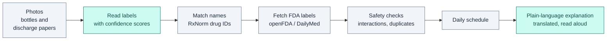

# PillPal

**Snap your pill bottles. Understand your medicines — in your own language.**

PillPal is an AI medication assistant for patients and family caregivers. Photograph your pill bottles and discharge paperwork, and PillPal combines every medication into one list and gives you, in plain language and your own language:

1. **What each medication is for and how to take it**
2. **One simple daily schedule** covering everything
3. **A safety cross-check** for interactions and duplicate drugs across the whole list

Everything can be **read aloud** for users with low literacy or low vision.

> **PillPal explains what is already prescribed. It never recommends changes.**
> Low-confidence readings are flagged, and anything risky directs the user to confirm with a pharmacist. PillPal is a hackathon prototype, not a medical device.

---

## Who it's for

- Older adults who don't speak English and are managing several prescriptions
- Recently discharged patients with medications from different doctors
- Family caregivers, near or far, helping someone stay on track

## How it works



<sub>Teal steps use AI (Claude). Gray steps are plain code and official databases.</sub>

**Grounded, not improvised.** The AI does two jobs only: reading the photos and writing the plain-language explanation. Name normalization, duplicate detection, interaction lookup, and scheduling are deterministic code built on official sources. Every statement links back to the FDA label it came from.

| Piece | Source |
|---|---|
| Label reading | Claude vision model, with per-field confidence scores |
| Drug name standardization | [RxNorm / RxNav API](https://lhncbc.nlm.nih.gov/RxNav/APIs/) (NLM) |
| Usage, warnings, interactions | [openFDA drug label API](https://open.fda.gov/apis/drug/label/) ([DailyMed](https://dailymed.nlm.nih.gov/) data) |
| Read aloud | Browser Web Speech API |

## Tech stack

- **Backend:** Python 3.11+, FastAPI
- **Frontend:** React + Vite + Tailwind, installable as a phone-friendly web app (PWA)
- **UI:** [shadcn/ui](https://ui.shadcn.com) components, [Magic UI](https://magicui.design) effects, [Motion](https://motion.dev) animations (respects "reduce motion")
- **Hosting:** Render (backend), Vercel (frontend)

## Repository layout

```
pillpal/
├── backend/
│   ├── app/
│   │   ├── main.py       API routes (/api/health, /api/analyze)
│   │   ├── analyze.py    runs the pipeline end to end
│   │   ├── models.py     shared data schemas (the backend ↔ frontend contract)
│   │   └── pipeline/     extract → normalize → labels → checks → schedule → explain
│   └── tests/
├── frontend/             React web app (src/App.jsx, src/components/)
├── samples/              Synthetic test photos and expected outputs (no real patient data)
├── .github/              CI (pytest + frontend build) and PR template
└── .env.example          Environment variables
```

| Pipeline step | File | AI? |
|---|---|---|
| Read photos → medication list with confidence | `extract.py` | Claude vision |
| Match names to RxNorm IDs + active ingredients | `normalize.py` | No |
| Fetch FDA label sections | `labels.py` | No |
| Duplicate, interaction and low-confidence checks | `checks.py` | No |
| One daily schedule | `schedule.py` | No |
| Plain-language explanation + translation | `explain.py` | Claude, grounded in label text |

## Getting started

### Prerequisites
- Python 3.11+
- Node.js 22 LTS (or 20.19+)
- An [Anthropic API key](https://console.anthropic.com/) (optional at first: without one, PillPal runs in **demo mode** with a sample medication list)
- (Optional) an [openFDA API key](https://open.fda.gov/apis/authentication/) for higher rate limits

### 1. Clone and configure
```bash
git clone https://github.com/calistaruiz/PillPal.git
cd PillPal
cp .env.example .env   # Windows: copy .env.example .env — then add your API keys
```

The app needs **two terminal windows running at the same time**: one for the backend
and one for the frontend. Leave both open while you work; press Ctrl+C to stop one.

### 2. Run the backend (terminal 1)

Mac/Linux:
```bash
cd backend
python -m venv .venv
source .venv/bin/activate
pip install -r requirements.txt
uvicorn app.main:app --reload
```

Windows (PowerShell):
```powershell
cd backend
python -m venv .venv
.venv\Scripts\Activate.ps1
pip install -r requirements.txt
uvicorn app.main:app --reload
```

You only need `python -m venv .venv` and `pip install` the first time. After that, activate
and run `uvicorn`. The backend is ready when it prints `Uvicorn running on http://127.0.0.1:8000`.
It has no screen of its own; http://localhost:8000/docs is an optional developer page for
testing the API by hand.

### 3. Run the frontend (terminal 2)

Mac/Linux:
```bash
cd frontend
npm install
npm run dev
```

Windows (PowerShell):
```powershell
cd frontend
npm.cmd install
npm.cmd run dev
```

`npm install` is only needed the first time and after someone adds a package.
Open the app at **http://localhost:5173**.

### 4. Run tests
```bash
cd backend
pytest
```

### Windows troubleshooting

**"running scripts is disabled on this system"** when activating the venv or running `npm`:
Windows blocks PowerShell scripts by default. Pick one:

- Lift the block for the current window only (resets when you close it):
  ```powershell
  Set-ExecutionPolicy -Scope Process -ExecutionPolicy Bypass
  ```
- Or avoid scripts entirely: use `npm.cmd` instead of `npm`, and call the venv's Python
  directly instead of activating:
  ```powershell
  .venv\Scripts\python -m pip install -r requirements.txt
  .venv\Scripts\python -m uvicorn app.main:app --reload
  ```
- Or allow local scripts permanently for your account (a security setting; your choice):
  ```powershell
  Set-ExecutionPolicy -Scope CurrentUser -ExecutionPolicy RemoteSigned
  ```

**`source` is not recognized:** that is the Mac/Linux command. Use
`.venv\Scripts\Activate.ps1` in PowerShell.

**`.env` not picked up (still in demo mode):** the file must be named exactly `.env`, sit in
the main PillPal folder (not in `backend/`), and the backend must be restarted after editing it.
Check http://localhost:8000/api/health: `"demo_mode": false` means the key was found.

## Contributing (team workflow)

- Branch from `main` with short names: `feat/schedule`, `fix/rxnorm-timeout`
- Open a PR and **squash merge**. Branches should live less than a day.
- Never commit `.env` files, API keys, or photos of real patient labels.
- Each person mostly works in their own folder to avoid merge conflicts.

## Roadmap

- [x] Project setup
- [ ] Photo → structured medication list with confidence flags
- [ ] RxNorm normalization and duplicate-ingredient detection
- [ ] openFDA interaction cross-check with citations
- [ ] Unified daily schedule
- [ ] Translation and read-aloud
- [ ] **Stretch:** caregiver share link so trusted relatives anywhere can review the plan

## Safety & privacy

- PillPal never suggests starting, stopping, or changing a medication.
- Readings below the confidence threshold are clearly marked for manual review.
- Interaction and duplicate warnings always include "Confirm with your pharmacist."
- Photos are processed for the session and are not stored.

## Team

Built for the vibeathon, October 2026, by:
- Calista Ruiz
- Haylie Boscia
- Ngoc Le

## License

MIT
